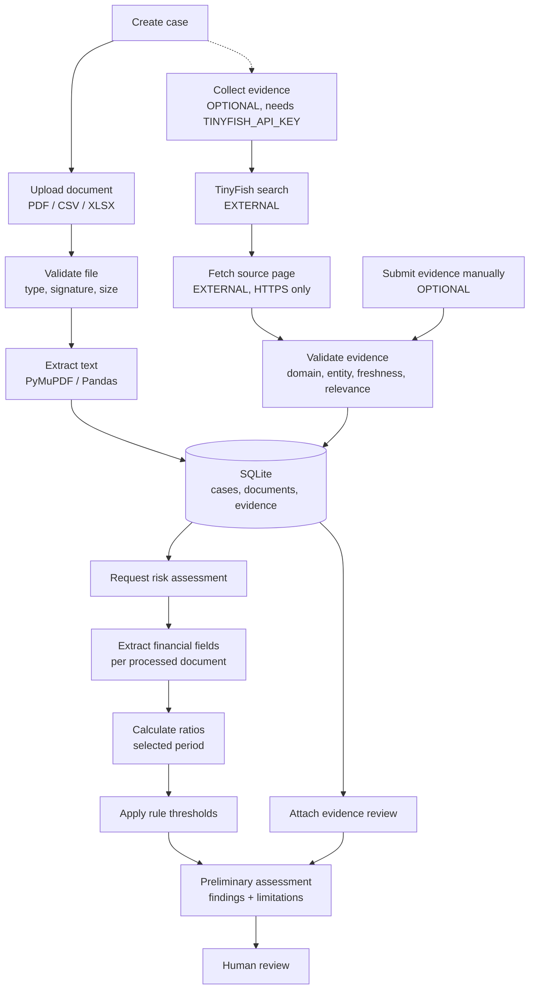
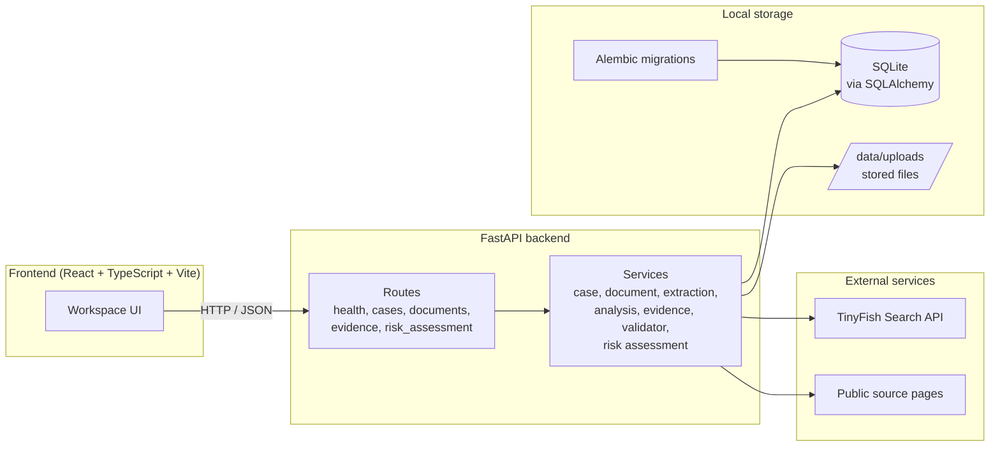
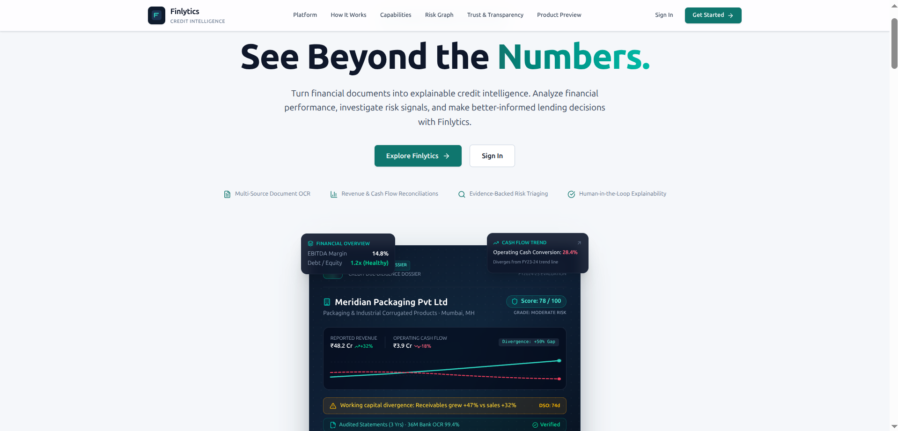

# Finlytics

**Financial Intelligence. Evidence-Driven Decisions.**


Finlytics is an evidence-driven financial investigation and preliminary risk analysis platform. It reads business financial documents, extracts key figures, calculates ratios, flags warning signs, gathers external evidence about the company, and validates that evidence for source, entity and relevance before an analyst relies on it.

A ratio tells you *what* looks off. Finlytics helps you find out *why* by tying each financial signal to external evidence and keeping every validation step visible. Reviewers see what the data indicates, what is still open, and what to ask next.

> **Built by Team PragniX** as a hackathon project. Finlytics supports analysts with preliminary analysis; credit decisions stay with people.

| | |
|---|---|
| Video walkthrough | [Watch on Google Drive](https://drive.google.com/file/d/1nGiVYMMS_bqvBR8UqDFTzAmCF_DjVoB_/view?usp=drive_link) |
| Repository | [github.com/DeepTensor-3070/Finlytics](https://github.com/DeepTensor-3070/Finlytics) |
| API docs (local) | `http://localhost:8000/docs` |

---

## Table of Contents

1. [Problem Statement](#problem-statement)
2. [Our Solution](#our-solution)
3. [Key Features](#key-features)
4. [How It Works](#how-it-works)
5. [Example Investigation](#example-investigation)
6. [Technical Architecture](#technical-architecture)
7. [Technology Stack](#technology-stack)
8. [Repository Structure](#repository-structure)
9. [Prerequisites](#prerequisites)
10. [Installation and Setup](#installation-and-setup)
11. [Environment Variables and Configuration](#environment-variables-and-configuration)
12. [API Reference](#api-reference)
13. [Testing and Quality Assurance](#testing-and-quality-assurance)
14. [Demo and Screenshots](#demo-and-screenshots)
15. [Scope, Security and Responsible Use](#scope-security-and-responsible-use)
16. [Roadmap](#roadmap)
17. [Team](#team)
18. [Acknowledgements and Disclaimer](#acknowledgements-and-disclaimer)
19. [Contributing and License](#contributing-and-license)

---

## Problem Statement

A lender reviewing a small business works through bank statements, GST returns, balance sheets and ledgers, then searches the web for anything that might change the picture. The work is repetitive, and it is hard to repeat the same way twice.

Financial statements only go so far. A weak current ratio or a falling margin says something is off, but not why. The explanation, when there is one, usually sits outside the documents: a regulatory action, a rating change, a customer in trouble.

External information brings its own questions:

- Does this search result describe the right company, or one with a similar name?
- Is the source recent, relevant and from a site worth trusting?
- Do sources agree, or say anything about the question at hand?
- Is a specific-sounding claim actually supported?

Analysts need a workflow where every figure traces back to a document, every external claim traces back to a source, and the checks applied to both are visible.

## Our Solution

Finlytics connects these stages into one investigation:

1. **Case creation.** Record the business, loan amount and purpose.
2. **Document ingestion.** Upload PDF, CSV or XLSX files; text is extracted and stored.
3. **Field extraction.** Pull revenue, net profit, total assets, total liabilities, current assets and current liabilities, with page and source-line references.
4. **Ratio analysis.** Compute net profit margin, current ratio, liabilities-to-assets and, when two periods are given, revenue growth.
5. **External evidence discovery.** Search the web through TinyFish, or submit evidence manually.
6. **Source and relevance validation.** Check URL, trusted-domain allowlist, entity match, freshness and keyword relevance.
7. **Preliminary risk assessment.** Apply transparent rule-based thresholds to the ratios and list external evidence beside them for review.
8. **Human review.** Every output carries its limitations, so reviewers always know what still needs checking.

Steps 1–7 run in the FastAPI backend behind a REST API, and the React frontend drives them through that API. The pipeline is deterministic and rule-based, which keeps every result explainable and reproducible.

## Key Features

**Status legend:** Implemented · Requires configuration · Roadmap

### Backend

| Feature | Status | Notes |
|---|---|---|
| Case management (create, list, read, update, change status, delete) | Implemented | Paginated list with optional `status` filter. Statuses: `created`, `documents_pending`, `analysis_pending`, `investigating`, `review_pending`, `completed`, `cancelled`. |
| Document upload (PDF, CSV, XLSX) | Implemented | Extension check, file-signature check, chunked size limit, SHA-256 checksum, generated storage filename. |
| Text extraction | Implemented | PDF via PyMuPDF (up to 500 pages); CSV and XLSX via Pandas (1,000 rows per sheet, 20 sheets). CSV in UTF-8. |
| Text-based PDFs | Implemented | Password-protected PDFs are rejected with a clear message. OCR for scanned PDFs is on the roadmap. |
| Financial field extraction | Implemented | Label matching on six fields. Handles currency symbols, units (thousand, lakh, crore, million, billion), bracketed negatives and explicit period labels. |
| Missing, ambiguous and multi-period values | Implemented | Each field returns `extracted`, `not_found`, `ambiguous` or `multi_period`, with all candidates and source lines. Nothing is guessed. |
| Ratio analysis | Implemented | `net_profit_margin`, `current_ratio`, `debt_to_assets` (total liabilities ÷ total assets × 100), `revenue_growth`. |
| Period selection | Implemented | `current_period` and `previous_period` query parameters. Values without period metadata are never assumed to belong to the requested period. |
| Risk indicators | Implemented | Rules for negative margin, low current ratio, and elevated or high liabilities-to-assets. Defaults live in code; exposing thresholds through the API is on the roadmap. |
| External evidence collection (TinyFish) | Requires configuration | Needs `TINYFISH_API_KEY`. Search, page fetch, text extraction, validation and persistence. |
| Manual evidence submission | Implemented | Uses the same validator as the automated path. |
| Evidence validation | Implemented | HTTPS URL, trusted-domain allowlist, exact entity match, 730-day freshness window, keyword relevance ≥ 0.30. |
| Evidence persistence and deduplication | Implemented | Stored per case with scores and reasons. Duplicate URLs (normalized, fragment ignored) are skipped, including after redirects. |
| Risk assessment endpoint | Implemented | Combines per-document extraction, analysis, rule findings and an evidence review list in one response. |
| Health and readiness | Implemented | `/health` and `/ready`. |
| Alembic migrations | Implemented | Four revisions covering cases, case fields, document storage and external evidence. |

### Frontend

A React workspace connected to the FastAPI backend: landing page, sign-in, overview, assessment workspace (six-stage stepper), documents, risk analysis, reports and settings.

| Feature | Status | Notes |
|---|---|---|
| Landing page | Implemented | |
| Sign-in and registration | Implemented | Handled in the browser for this prototype; server-side authentication is on the roadmap. |
| Overview dashboard, assessments list and workspace | Implemented | Backed by the API. |
| Document upload and viewer | Implemented | |
| Financial analysis view with charts | Implemented | Recharts. |
| Risk findings and review workflow | Implemented | |
| Report view with Markdown and PDF export | Implemented | Export is generated client-side from the displayed content. |

## How It Works

1. **Create a case.** `POST /api/v1/cases` with business name, loan amount and purpose.
2. **Upload documents.** `POST /api/v1/cases/{case_id}/documents` with a PDF, CSV or XLSX. The file is validated, its text extracted, and both are stored.
3. **Collect external evidence (optional).** `POST /api/v1/cases/{case_id}/evidence/collect` searches TinyFish, fetches each result page, validates it and stores it. Evidence can also be submitted by hand with `POST /api/v1/cases/{case_id}/evidence`.
4. **Request a risk assessment.** `POST /api/v1/cases/{case_id}/risk-assessment`, optionally with `current_period` and `previous_period`. The service extracts fields from every processed document, calculates ratios, applies the rules and attaches the stored evidence.
5. **Review.** The response lists findings with their formulas and inputs, any ambiguous or missing values, evidence dispositions, and limitations. A person decides what to do with it. The React workspace walks through the same steps: create an assessment, upload documents, review extraction and analysis, investigate findings, and read the report.



Solid arrows are the core path. Dashed and labelled-optional steps need extra configuration or input. The whole flow is deterministic: no model inference sits in the execution path, so the same inputs give the same outputs.

## Example Investigation

> **Synthetic example.** Every figure and name below is invented to illustrate the workflow. None of it is real company data or a measured result from this project.

**Observed values** (as extracted from an uploaded statement for a fictional "Example Traders Pvt Ltd"):

| Field | FY 2023–24 | FY 2024–25 |
|---|---|---|
| Revenue | ₹4.00 crore | ₹4.60 crore |
| Current assets | | ₹1.80 crore |
| Current liabilities | | ₹2.40 crore |

**Calculated indicators** (request with `current_period=2024-2025&previous_period=2023-2024`):

- Revenue growth: (4.60 − 4.00) ÷ 4.00 × 100 = **15.00%**
- Current ratio: 1.80 ÷ 2.40 = **0.75**, below the default threshold of 1.0, so the `weak_current_ratio` finding is raised.

**Investigation hypothesis** (written by the analyst): revenue is growing while short-term obligations outpace liquid assets. Slow customer payments, heavy short-term borrowing or a one-off payable could each produce this. The ratio alone cannot separate them, which is exactly why the next step is evidence.

**Retrieved external claims.** The analyst runs evidence collection with the query `"Example Traders Pvt Ltd" credit rating downgrade` and expected entity `Example Traders Pvt Ltd`. Two results come back:

| Result | Validation outcome | Why |
|---|---|---|
| Page on a domain in the trusted allowlist, dated within two years, excerpt mentions the company | `valid` | All configured checks passed. The analyst still reads the source to confirm the claim. |
| Page on an unlisted news site with no detectable publication date | `needs_review` | Untrusted domain and missing date, so it is queued for a manual look. |

**Human-reviewed conclusion.** The analyst reads the `valid` source, confirms it concerns this business and this question, and asks the borrower for a receivables ageing report. The assessment never asserts a cause. A weak current ratio is a prompt for good questions; it is not evidence of fraud, distress or misreporting.

## Technical Architecture



**Component responsibilities**

| Component | Responsibility |
|---|---|
| `backend/app/main.py` | Builds the FastAPI app, configures logging and CORS, registers routers, creates upload and database directories on startup. |
| `api/routes/` | `health`, `cases`, `documents`, `evidence`, `risk_assessment`. Thin HTTP layer that maps service results to status codes. |
| `schemas/` | Pydantic request and response models for cases, documents and evidence. |
| `services/case_service.py` | Case CRUD and status updates. |
| `services/document_service.py` | Upload validation, text extraction, storage, rollback on failure. |
| `services/financial_extraction_service.py` | Label-based extraction of six fields, period detection, ambiguity handling. |
| `services/financial_analysis_service.py` | Ratio calculation with `Decimal`, period selection, currency compatibility checks. |
| `services/risk_assessment_service.py` | Rule thresholds, findings, evidence dispositions. |
| `services/case_risk_assessment_service.py` | Loads a case, runs extraction, analysis and assessment, builds the response. |
| `services/tinyfish_client.py` | Calls the TinyFish search endpoint and normalizes results. |
| `services/source_extractor.py` | Fetches HTTPS pages (HTML, PDF, plain text) within a 2 MB limit, extracts text and publication date. |
| `services/evidence_validator.py` | Trusted-domain, entity, freshness and relevance checks. |
| `services/evidence_collection_service.py` | Search → fetch → dedupe → validate → persist. |
| `services/evidence_service.py` | Persist and list evidence for a case. |
| `services/external_research_service.py` | Query builder and result normalizer for research workflows. |
| `core/config.py`, `core/database.py` | Settings (Pydantic Settings, `.env`) and the SQLAlchemy engine and session. |
| `migrations/` | Alembic environment and four revisions. |

## Technology Stack

| Technology | Role | Status |
|---|---|---|
| Python 3.12 | Backend language (`requires-python >=3.12`) | In use |
| FastAPI | REST API, OpenAPI and Swagger UI | In use |
| Uvicorn | ASGI server | In use |
| Pydantic / Pydantic Settings | Request validation, configuration from `.env` | In use |
| SQLAlchemy | ORM and sessions | In use |
| Alembic | Schema migrations | In use |
| SQLite | Default database (`sqlite:///./data/finlytics.db`) | In use |
| PyMuPDF | PDF text extraction (uploads and fetched sources) | In use |
| Pandas, OpenPyXL | CSV and XLSX parsing | In use |
| HTTPX | TinyFish calls and source-page fetching | In use |
| BeautifulSoup 4 | HTML parsing for source pages | In use |
| Jinja2 | Template support in `main.py` | Available |
| TinyFish Search API | External web search for evidence | In use when `TINYFISH_API_KEY` is set |
| Pytest, pytest-asyncio, pytest-cov | Backend tests | Configured |
| React 19, TypeScript (strict), Vite | Frontend | In use |
| Tailwind CSS v4 | Styling | In use |
| React Router, TanStack Query | Routing, data fetching and caching | In use |
| React Hook Form, Zod | Forms and validation | In use |
| Recharts, Lucide | Charts, icons | In use |
| jsPDF | Client-side PDF export of reports | In use |
| Vitest, Testing Library, ESLint | Frontend tests and linting | Configured |
| Groq | LLM provider for upcoming investigation features | Settings reserved; roadmap |
| LangGraph, XGBoost, SHAP, PostgreSQL, FAISS, ChromaDB, OCR | Explored in the original proposal | Roadmap |

## Repository Structure

```text
finlytics/
├── README.md
├── pyproject.toml            # Backend dependencies (source of truth)
├── .python-version           # 3.12
├── alembic.ini               # script_location = migrations
├── backend/
│   └── app/
│       ├── main.py           # create_app(), CORS, router registration
│       ├── api/routes/       # health, cases, documents, evidence, risk_assessment
│       ├── core/             # config.py, database.py
│       ├── models/           # case, document, evidence (SQLAlchemy models)
│       ├── schemas/          # case, document, evidence
│       └── services/         # extraction, analysis, risk, evidence, TinyFish
├── migrations/
│   ├── env.py
│   └── versions/             # 4 revisions
├── tests/                    # Backend pytest suite
├── docs/                     # project.md, sol.md, tech.md (original proposal)
└── frontend/
    ├── package.json
    ├── vite.config.ts
    └── src/
        ├── app/              # router, providers, layouts
        ├── components/       # ui primitives, feedback, data display
        ├── features/         # assessments, auth, dashboard, documents,
        │                     # financial-analysis, landing, reports,
        │                     # risk-analysis, settings
        ├── services/         # api client, file upload
        ├── lib/  hooks/  types/  styles/
        └── test/             # Vitest suites
```

`docs/` holds the original project proposal. The README and the code describe what is built today.

## Prerequisites

**Backend**

- Python 3.12 or newer
- [uv](https://docs.astral.sh/uv/) (dependencies are defined in `pyproject.toml`)
- No database server needed; SQLite is created on first use
- A TinyFish API key for automated evidence collection (optional; everything else runs without it)

**Frontend**

- Node.js and npm. Use a current LTS release that supports Vite 8 and Vitest 5.
- No API keys. Keep secrets out of `VITE_*` variables.

## Installation and Setup

Run backend commands from the **repository root** so relative paths (`data/finlytics.db`, `data/uploads`, and the Alembic path) resolve in the right place.

### 1. Clone

```bash
git clone https://github.com/DeepTensor-3070/Finlytics.git finlytics
cd finlytics
```

### 2. Install backend dependencies

```bash
uv sync
```

### 3. Create `.env`

Create `.env` in the repository root using the names in [Environment Variables](#environment-variables-and-configuration). A minimal file:

```dotenv
ENVIRONMENT=development
LOG_LEVEL=INFO
DATABASE_URL=sqlite:///./data/finlytics.db
UPLOAD_DIR=data/uploads
MAX_UPLOAD_SIZE_MB=15
TINYFISH_API_KEY=
```

Add your TinyFish key to enable evidence collection. Keep `.env` out of version control.

### 4. Apply migrations

```bash
uv run alembic upgrade head
```

This creates the tables. `alembic.ini` points at the same default SQLite path as the app; if you change `DATABASE_URL`, make sure `migrations/env.py` uses the same database.

### 5. Allow the frontend origin (CORS)

Set `CORS_ORIGINS` to the Vite dev server's address. It is read from the process environment (not from `.env`):

```bash
# macOS / Linux
export CORS_ORIGINS="http://localhost:5173,http://127.0.0.1:5173"
```

```powershell
# Windows PowerShell
$env:CORS_ORIGINS = "http://localhost:5173,http://127.0.0.1:5173"
```

### 6. Start the backend

```bash
uv run uvicorn backend.app.main:app --reload --port 8000
```

Verify it:

```bash
curl http://localhost:8000/health
# {"status":"ok","service":"finlytics-api"}
```

**Troubleshooting.** `main.py` serves `frontend/static` and `frontend/templates`. If startup reports a missing directory, create them:

```bash
mkdir -p frontend/static frontend/templates
```

### 7. Install and start the frontend

In a second terminal:

```bash
cd frontend
npm install
```

Create `frontend/.env`:

```dotenv
VITE_DATA_MODE=live
VITE_API_BASE_URL=http://localhost:8000
VITE_MAX_UPLOAD_MB=25
```

```bash
npm run dev
```

The app runs at `http://localhost:5173` and talks to the backend at `VITE_API_BASE_URL`. Start the backend first (step 6) and make sure its CORS origins include the Vite URL (step 5).

### 8. Run the tests

See [Testing and Quality Assurance](#testing-and-quality-assurance).

## Environment Variables and Configuration

### Backend

Loaded from `.env` in the repository root by `backend/app/core/config.py`, unless noted.

| Variable | Purpose | Required | Default | Used by |
|---|---|---|---|---|
| `APP_NAME` | API title | No | `Finlytics API` | `main.py` |
| `APP_VERSION` | API version | No | `0.1.0` | `main.py` |
| `ENVIRONMENT` | Label shown in startup log | No | `development` | `main.py` |
| `LOG_LEVEL` | Logging level | No | `INFO` | `main.py` |
| `DATABASE_URL` | SQLAlchemy URL | No | `sqlite:///./data/finlytics.db` | `database.py`, `main.py` |
| `UPLOAD_DIR` | Where uploaded files are stored | No | `data/uploads` | `document_service.py`, `main.py` |
| `MAX_UPLOAD_SIZE_MB` | Upload limit, integer 1–100 | No | `15` | `document_service.py` |
| `TINYFISH_API_KEY` | TinyFish search credential | For `/evidence/collect` | empty | `tinyfish_client.py` |
| `API_V1_PREFIX` | API prefix setting | No | `/api/v1` | Reserved; routers use `/api/v1` |
| `GROQ_API_KEY` | LLM provider key | No | empty | Reserved for upcoming features |
| `GROQ_MODEL` | LLM model name | No | `openai/gpt-oss-120b` | Reserved for upcoming features |
| `CORS_ORIGINS` | Comma-separated allowed origins | No | `http://localhost:8501,http://127.0.0.1:8501` | `main.py`. Set as an environment variable, not a `.env` entry. |

Variable names are case-insensitive, and unknown entries in `.env` are ignored.

### Frontend (Vite)

Set in `frontend/.env`.

| Variable | Purpose | Default |
|---|---|---|
| `VITE_DATA_MODE` | `live` calls the FastAPI backend; `demo` switches to the built-in synthetic adapter | `live` (set explicitly) |
| `VITE_API_BASE_URL` | FastAPI base URL | `http://localhost:8000` |
| `VITE_MAX_UPLOAD_MB` | Client-side upload limit; keep in sync with the backend's `MAX_UPLOAD_SIZE_MB` | `25` |

All `VITE_*` values are bundled into public JavaScript, so keep credentials out of them.

## API Reference

Base URL (local): `http://localhost:8000`. Case, document, evidence and risk routes live under `/api/v1`. Errors use FastAPI's `{"detail": ...}` shape.

**Interactive docs:** Swagger UI at `/docs`, ReDoc at `/redoc`, OpenAPI schema at `/openapi.json`.

### Endpoints

| Method | Path | Success | Notes |
|---|---|---|---|
| GET | `/health` | 200 | `{"status":"ok","service":"finlytics-api"}` |
| GET | `/ready` | 200 | Process readiness |
| POST | `/api/v1/cases` | 201 | Body below |
| GET | `/api/v1/cases` | 200 | Query: `limit` (1–100, default 20), `offset` (≥0), `status`. Returns `{items,total,limit,offset}` |
| GET | `/api/v1/cases/{case_id}` | 200 | 404 if missing |
| PATCH | `/api/v1/cases/{case_id}` | 200 | Any of `business_name`, `business_type`, `loan_amount`, `loan_purpose`, `notes` |
| PATCH | `/api/v1/cases/{case_id}/status` | 200 | Body `{"status": "<one of the seven statuses>"}` |
| DELETE | `/api/v1/cases/{case_id}` | 204 | |
| POST | `/api/v1/cases/{case_id}/documents` | 201 | `multipart/form-data`, field `file` |
| GET | `/api/v1/cases/{case_id}/documents` | 200 | `{items,total}`, newest first |
| GET | `/api/v1/cases/{case_id}/documents/{document_id}` | 200 | 404 if not in this case |
| POST | `/api/v1/cases/{case_id}/evidence` | 201 | Returns `{evidence, validation}` |
| GET | `/api/v1/cases/{case_id}/evidence` | 200 | `{items,total}`, newest first |
| POST | `/api/v1/cases/{case_id}/evidence/collect` | 200 | Needs `TINYFISH_API_KEY` |
| POST | `/api/v1/cases/{case_id}/risk-assessment` | 200 | Query: `current_period`, `previous_period` |

### Request schemas

**Create case** (`CaseCreate`)

| Field | Type | Rules |
|---|---|---|
| `business_name` | string | required, trimmed, 1–255 chars |
| `business_type` | string | optional, ≤100 |
| `loan_amount` | number | required, > 0, finite |
| `loan_purpose` | string | required, 1–500 |
| `currency` | string | `"INR"` (default) |
| `notes` | string | optional, ≤5000 |

**Submit evidence** (`EvidenceCreate`): `claim` (1–5000), `source_name` (1–255), `source_url` (valid URL), and optional `excerpt` (≤20000), `entity_name` (≤255), `expected_entity` (≤255), `published_at` (datetime).

**Collect evidence** (`EvidenceCollectionRequest`): `query` (3–500 chars), `expected_entity` (2–200 chars), `max_results` (1–10, default 5).

### Upload responses

| Code | Meaning |
|---|---|
| 201 | Document stored and processed |
| 400 | Empty file, or content does not match its extension (bad PDF header, invalid XLSX structure, non-UTF-8 CSV) |
| 404 | Case not found |
| 413 | File larger than `MAX_UPLOAD_SIZE_MB` |
| 415 | Extension is not `.pdf`, `.csv` or `.xlsx` |
| 422 | Password-protected PDF, PDF over 500 pages, or unreadable file |
| 500 | Database or unexpected processing failure |

### Collect-evidence responses

| Code | Meaning |
|---|---|
| 200 | Run summary returned |
| 404 | `Case not found.` |
| 422 | Invalid input, such as an empty `expected_entity` |
| 502 | TinyFish unavailable or not configured (the message names the cause, for example `TINYFISH_API_KEY is not configured.`) |

### Examples

Replace `<case_id>` with a real ID. Data is synthetic.

```bash
# Create a case
curl -X POST http://localhost:8000/api/v1/cases \
  -H "Content-Type: application/json" \
  -d '{
        "business_name": "Example Traders Pvt Ltd",
        "business_type": "Trading",
        "loan_amount": 5000000,
        "loan_purpose": "Working capital"
      }'
```

```bash
# Upload a financial statement
curl -X POST http://localhost:8000/api/v1/cases/<case_id>/documents \
  -F "file=@./example_statements.xlsx"
```

```bash
# Submit evidence manually
curl -X POST http://localhost:8000/api/v1/cases/<case_id>/evidence \
  -H "Content-Type: application/json" \
  -d '{
        "claim": "Example Traders Pvt Ltd rating action",
        "source_name": "Example rating agency",
        "source_url": "https://www.crisil.com/example-page",
        "excerpt": "Example Traders Pvt Ltd was reviewed by the agency in 2026.",
        "entity_name": "Example Traders Pvt Ltd",
        "expected_entity": "Example Traders Pvt Ltd",
        "published_at": "2026-03-01T00:00:00Z"
      }'
```

```bash
# Collect evidence through TinyFish
curl -X POST http://localhost:8000/api/v1/cases/<case_id>/evidence/collect \
  -H "Content-Type: application/json" \
  -d '{
        "query": "\"Example Traders Pvt Ltd\" credit rating",
        "expected_entity": "Example Traders Pvt Ltd",
        "max_results": 5
      }'
```

The response summarizes the run: `searched`, `saved`, `valid`, `needs_review`, `rejected`, `duplicates_skipped`, and an `items` array with per-result status and reasons.

```bash
# Preliminary risk assessment for specific periods
curl -X POST "http://localhost:8000/api/v1/cases/<case_id>/risk-assessment?current_period=2024-2025&previous_period=2023-2024"
```

Period strings match what the extractor detected in the document. A label such as `FY 2024-25` becomes `2024-2025`; a single year such as `FY2025` becomes `2025`.

### Risk assessment response

Top-level keys: `case_id`, `business_name`, `assessment_type`, `documents_found`, `documents_analyzed`, `documents` (per-document extraction), `financial_fields`, `financial_analysis` (metrics with formula, inputs, status and reason), `risk_assessment`, `external_evidence_count`, `external_evidence`, `limitations`.

`risk_assessment` contains `overall_status` (`findings_require_review`, `insufficient_information` or `no_configured_indicators_triggered`), `findings` sorted by severity, `external_evidence_review`, `limitations`, `thresholds` and a `disclaimer`.

Default rules:

| Finding | Condition | Severity |
|---|---|---|
| `negative_profit_margin` | net profit margin < 0 | high |
| `weak_current_ratio` | current ratio < 1.0 | high |
| `elevated_liabilities_to_assets` | liabilities ÷ assets ≥ 60% | medium |
| `high_liabilities_to_assets` | liabilities ÷ assets ≥ 75% | high |

External evidence appears alongside the findings with a disposition (`validated_source_requires_fact_review`, `requires_manual_review` or `excluded_rejected_source`), so reviewers see both views side by side.

### Evidence validation

| Check | Rule |
|---|---|
| URL | HTTPS only; no credentials in the URL |
| Trusted domain | Exact match or subdomain of the allowlist (RBI, SEBI, MCA, NCLT, IBBI, India Code, CRISIL, ICRA, NSE, BSE, India Ratings) |
| Entity match | `entity_name` equals `expected_entity` after case and whitespace normalization |
| Freshness | Publication date present, not in the future, within 730 days |
| Relevance | At least 30% of claim and entity keywords appear in the excerpt |

Outcomes: `rejected` when the claim, source name, excerpt or a valid URL is missing, the entity does not match, or the date is in the future. Otherwise `needs_review`, unless the domain is trusted, the date is fresh and the excerpt is relevant, in which case `valid`. The credibility score is 1.0 for allowlisted domains and 0.0 otherwise.

In automated collection, the expected entity is the entity you searched for; independent entity resolution is on the roadmap.

## Testing and Quality Assurance

**Backend** (from the repository root):

```bash
uv run pytest -q
```

Pytest is configured in `pyproject.toml` (`testpaths = ["tests"]`, `pythonpath = ["."]`). Test modules:

| File | Area |
|---|---|
| `test_health.py` | Health and readiness endpoints |
| `test_database.py` | Database layer |
| `test_api_integration.py` | API-level integration |
| `test_document_service.py` | Upload validation and extraction |
| `test_financial_extraction_service.py` | Field extraction |
| `test_financial_analysis_service.py` | Ratio calculation |
| `test_risk_assessment_service.py` | Risk rules |
| `test_evidence_validator.py` | Evidence validation |
| `test_evidence_collection_service.py` | Evidence collection |

For coverage: `uv run pytest --cov=backend`.

**Frontend** (from `frontend/`):

```bash
npm test             # Vitest + Testing Library
npm run typecheck    # tsc --noEmit (strict)
npm run lint         # ESLint
npm run build        # type-check, then production build
```

Frontend suites: `app`, `auth`, `formatters`, `validate`, `workflow`.

Run these commands to confirm results in your own environment.

**Correctness built into the design**

- Extraction returns candidates with page numbers and source lines, and marks conflicts `ambiguous` instead of picking one.
- Values from different reporting periods stay separate. A field found in more than one document is flagged for review rather than silently merged.
- Ratios use `Decimal` and return a reason, not a guess, when inputs are missing, ambiguous, zero or in different currencies.
- Uploads are stored under generated filenames; a failed upload removes its file and rolls back the database change.
- Fetched source pages are limited to HTTPS, 2 MB and five redirects, and error pages are filtered out.

## Demo and Screenshots

| Screen | File |
|---|---|
| Landing page | `docs/screenshots/01-landing.png` |
| Dashboard | `docs/screenshots/02-dashboard.png` |
| Case / assessment creation | `docs/screenshots/03-new-assessment.png` |
| Document upload and extraction | `docs/screenshots/04-documents.png` |
| Financial analysis | `docs/screenshots/05-financial-analysis.png` |
| External evidence and validation | `docs/screenshots/06-evidence.png` |
| Final risk assessment | `docs/screenshots/07-risk-assessment.png` |

```markdown

```

**Try the full stack.** Start the backend and frontend as described in [Installation and Setup](#installation-and-setup), open `http://localhost:5173`, create an assessment, upload a PDF, CSV or XLSX statement, and step through extraction, analysis, risk investigation and the report. You can also exercise the backend directly through Swagger UI at `http://localhost:8000/docs` or the cURL examples above.

Use synthetic or anonymized documents when demonstrating, and keep real borrower data off shared instances.

## Scope, Security and Responsible Use

Finlytics is a hackathon prototype built to support analysts with preliminary analysis. It does not approve, reject or price credit.

**What the analysis covers**

- Six extracted fields and four ratios, each shown with its formula, inputs and source lines.
- Text-based PDFs, CSV and XLSX files. Extraction matches labels and numbers on text lines, so reviewers should confirm key figures against the original document, especially in multi-column tables.
- `debt_to_assets` uses all reported liabilities, not only interest-bearing debt.
- Ratios inform the conversation about creditworthiness; they do not settle it.

**How external evidence is treated**

- Collection runs through TinyFish and depends on its availability and a valid key.
- The trusted-domain allowlist and the credibility score mark where a source comes from. A reviewer still judges whether its claim is true.
- Freshness uses the detected publication date. Pages without one go to `needs_review`, so nothing undated is accepted automatically.
- Relevance is a keyword-overlap check, a fast first filter ahead of human reading.
- Evidence is listed next to the findings for review and does not alter their severity.

**Security in this prototype**

- Uploads get signature checks, size limits, generated filenames and cleanup on failure.
- Server-side fetches are HTTPS-only, size-limited and redirect-limited, and reject URLs with embedded credentials.
- CORS is limited to a configured origin list, with credentials disabled.
- The API runs without authentication, rate limiting or audit logging, so run it locally or on a trusted network for now.
- Sign-in in the frontend is handled in the browser. Use test credentials only.
- Uploaded files and the SQLite database are stored on local disk.

**Production hardening plan:** authentication and role-based access, rate limiting, audit logging, secret management, privacy and retention controls, a production database with backups, OCR, private-address filtering for server-side fetches, and deployment configuration.

**Human verification** of extracted figures, ratios and external claims is part of the workflow by design.

## Roadmap

**Delivered**

- Case, document and evidence APIs with SQLite persistence and migrations
- PDF, CSV and XLSX ingestion and text extraction
- Six-field extraction with ambiguity and multi-period handling
- Four ratios with period selection
- Rule-based findings with explanations
- TinyFish evidence collection, source-page extraction, validation and deduplication
- Preliminary assessment endpoint
- React workspace connected to the API

**Next**

- OCR for scanned documents and stronger table extraction
- Claim-level support checking and cross-source corroboration
- Independent entity resolution for collected evidence
- Evidence-aware risk scoring and API-configurable thresholds
- Receivables, cash-flow and trend analysis
- LLM-assisted investigation questions with source citations
- Audit trail of findings and reviewer actions
- Server-side authentication, access control and rate limiting
- PostgreSQL and a deployment configuration
- Wider automated test coverage and monitoring

## Team

**Team PragniX**

- Subhanshu
- Lokesh
- Sajal
- Abhyudaya

The team built Finlytics together.

## Acknowledgements and Disclaimer

Finlytics builds on FastAPI, SQLAlchemy, Alembic, Pydantic, PyMuPDF, Pandas, HTTPX, BeautifulSoup, React, Vite, TanStack Query, Recharts and the other open-source libraries listed in `pyproject.toml` and `frontend/package.json`. External search is provided by TinyFish when configured.

**Disclaimer.** Finlytics provides preliminary analytical support. It is not a substitute for professional financial, legal or credit-risk judgment, an audit opinion, or independent verification of financial statements or external claims.

## Contributing and License

**Contributing.** Open an issue or a pull request against the main branch. Keep changes small and focused, add or update tests for backend logic, and run `uv run pytest -q` and, for frontend changes, `npm run typecheck && npm run lint && npm test` before submitting. Keep `.env` files, API keys, the `data/` directory and real financial documents out of commits.

**License.** The team will add a license file; until then, all rights remain with the authors.